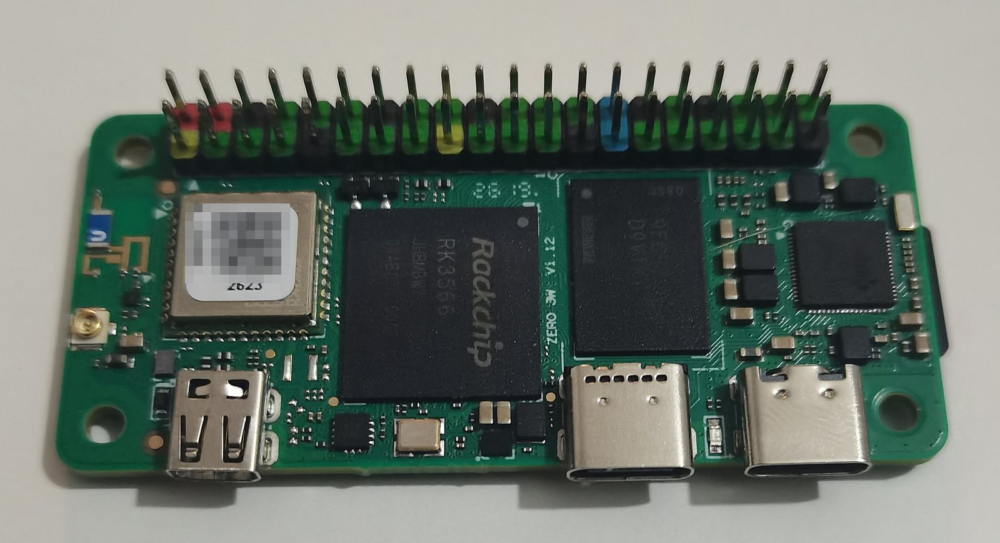
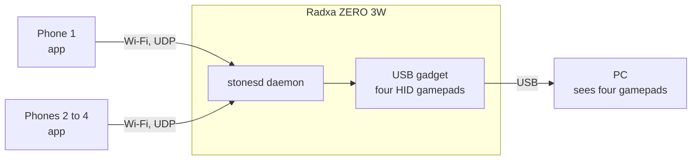

# Phones as USB gamepads

Up to four Android phones become USB gamepads for a PC. A Radxa ZERO 3W board, plugged into the PC's USB port
(the same cable powers it), presents itself as four generic HID gamepads, and each phone drives one of them
over Wi-Fi.

Phone-as-gamepad apps usually install a virtual driver on the PC. Here the PC only sees ordinary USB hardware,
so nothing is installed on the PC you play on. I built it for split-screen co-op on Steam with two phones and
no controllers.

The app is called Sending Stones, and the PC lists the pads as "Sending Stones Pad".

The board joins your Wi-Fi and the app finds it there over mDNS (the protocol runs on UDP port 40400). Each
player picks Player 1 to 4 in the app, optionally behind a 4-digit PIN set on the board.
A phone sends its whole pad state on every change and again every 100 ms, so a lost packet is corrected by the
next one. A pad whose phone goes silent for 300 ms returns to neutral.

Needs: a Radxa ZERO 3W (other boards: [below](#boards)), one Android 8+ phone per player, a Wi-Fi network shared by the
board and the phones, and a Linux computer with Rust and SSH access to the board, to build and install the board
software once. That computer can be the PC you play on; playing itself needs nothing installed. The app is
`sending-stones-<version>.apk` on the
[Releases page](https://github.com/Saccharoze/phones-as-usb-gamepads/releases/latest), or builds with the Android
SDK.

## Status

- Tested with a Linux PC as the host: all four pads appear, the phone app drives its pad, a silent phone's pad
  returns to neutral. Pads 3 and 4 were driven from the PC, standing in for phones.
- Steam on that PC lists all four pads as controllers and maps every button by itself: its "Test Device Inputs"
  screen shows each phone button under its own name.
- Not tested yet: a game, Windows.

## Steps

1. [Install](docs/01-install.md): board software, Wi-Fi, the app, first test
2. [How it works](docs/02-how-it-works.md): USB gadget, HID report, network protocol, fail-safe, app

## Boards

Tested: Radxa ZERO 3W, on Armbian with the vendor kernel 6.1.

Another board should work if it has:

1. a USB port that can run in device mode (once enabled, `/sys/class/udc` lists a controller);
2. a kernel with USB gadget configfs and its HID function;
3. Wi-Fi, or Ethernet on the phones' network;
4. a 64-bit ARM CPU, since `cargo xtask` builds for `aarch64-unknown-linux-musl`. Another CPU needs another Rust
   target.

Not tested, but these meet the list on paper:

| Board | What changes |
|---|---|
| Radxa ZERO 3E | Same chip, Ethernet instead of Wi-Fi: the phones reach it through the router |
| Raspberry Pi Zero 2 W | 64-bit Raspberry Pi OS; device mode on the micro-USB data port with `dtoverlay=dwc2`; 2.4 GHz Wi-Fi only |
| Raspberry Pi 4 Model B | Device mode on the USB-C power port with `dtoverlay=dwc2`; it can draw more power than a PC port supplies |

The [Install](docs/01-install.md) page is written for the ZERO 3W on Armbian. On another board, enabling device
mode on the USB port and joining the Wi-Fi work differently.

## Next

What I want to work on:

1. Play a split-screen co-op game through Steam with two to four phones, on this Linux PC, then on Windows.
2. Measure latency over Wi-Fi, from the phone to the PC. The [measured numbers](docs/02-how-it-works.md#latency)
   stop at the board's USB network link.
3. Games without Steam Input: Windows games that only read XInput don't see a generic HID gamepad. An Xbox
   360-compatible mode would cover them. Windows' built-in driver for it binds to a vendor-specific interface with
   Microsoft's vendor and product IDs, so that means a new gadget function, not a new HID descriptor.
4. Rumble: the pads have no output report, so game vibration doesn't reach the phones.
5. Slots with a PIN: with a PIN set, a phone can take a held slot over. Two phones that pick the same player
   then take it from each other in turn. And the player screen doesn't offer a held slot, even when the PIN would
   allow taking it over.
6. IPv6: the board listens on IPv4 only.
7. A layout editor in the app. Today the button positions are constants in the app's `Layout.kt`.
8. Try a Raspberry Pi Zero 2 W.

## Repository layout

| Folder | Content |
|---|---|
| `board/` | runs on the board, in Rust: `proto/` shared protocol code, `daemon/` (`stonesd`), `scripts/` USB gadget, services, installer |
| `phone/` | the Android app (Kotlin, Jetpack Compose) |
| `dev/` | runs on the computer that builds and installs: `xtask/` build and deploy over SSH, `e2e_latency.py` latency measurement |
| `docs/` | write-ups |

## License

MIT, see [LICENSE](LICENSE). The Gradle wrapper (`phone/gradlew`, `phone/gradlew.bat`, `phone/gradle/wrapper/`)
is Gradle's, under the Apache License 2.0.
