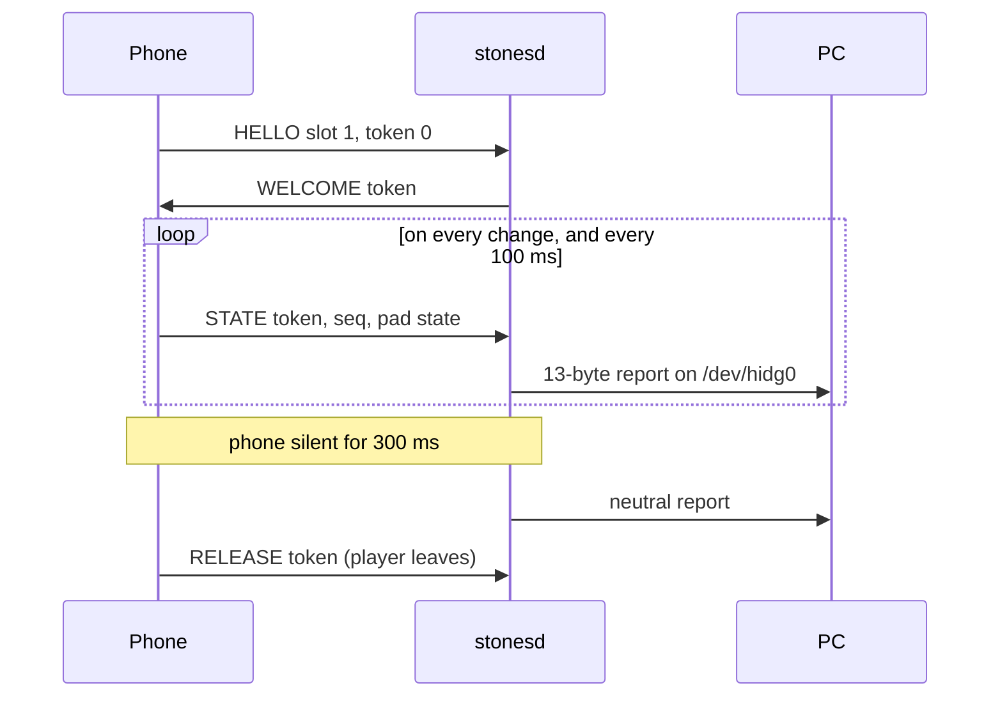

# How it works

A touch on the phone becomes a pad state. The app sends it over UDP to `stonesd` on the board, which writes it
as a 13-byte HID report to `/dev/hidg0` or `/dev/hidg1`. The board's USB gadget hands that report to the PC the
next time the PC polls the pad.

## The USB gadget

`board/scripts/setup.sh` builds the gadget through configfs, the kernel's file interface for USB gadgets. One
USB device carries two HID functions, one per pad, each with the same 89-byte report descriptor. Slot 1 drives
`/dev/hidg0`, slot 2 `/dev/hidg1`. The PC sees
two gamepads named "Sending Stones Pad" and drives them with its built-in HID driver, so nothing is installed on
it (checked on Linux). Each pad has a 13-byte interrupt endpoint polled every 1 ms at high speed (`bInterval` 4).

The descriptor lives in one place, `board/proto/src/descriptor.rs`. `install.sh` writes it to a file with
`stonesd --write-descriptor`, and `setup.sh` gives that file to configfs.

The device uses the Linux Foundation's vendor ID `0x1d6b` with product ID `0x0104`, the IDs meant for gadget
development. A product sold to others would need its own.

Two options come from `/etc/sending-stones/gadget.env`. `WITH_ECM=1` adds a USB network function for SSH
during development, for a Linux PC only: Windows has no built-in driver for it. `TAKEOVER=1` unbinds a gadget the board image may have bound to the port at boot, and
`setup.sh down` binds it again.

## The HID report

One generic gamepad: 16 buttons, a hat switch, two sticks and two analog triggers.

| Bytes | Field | Type | Values |
|---|---|---|---|
| 0-1 | Buttons 1-16 | 16 bits, little-endian | bit 0 A, 1 B, 3 X, 4 Y, 6 LB, 7 RB, 10 View, 11 Menu, 12 Guide, 13 L3, 14 R3; bits 2, 5, 8, 9 and 15 always 0 |
| 2 | D-pad | hat in the low 4 bits, high 4 bits 0 | 0 up, clockwise in 45° steps to 7 up-left, 8 released |
| 3-4 | Left stick X | int16 LE | -32767 to 32767, right positive |
| 5-6 | Left stick Y | int16 LE | down positive (the HID convention) |
| 7-8 | Right stick X | int16 LE | right positive |
| 9-10 | Right stick Y | int16 LE | down positive |
| 11 | Left trigger | uint8 | 0 to 255 |
| 12 | Right trigger | uint8 | 0 to 255 |

The neutral report is buttons 0, hat 8, sticks and triggers 0. The board rejects a report the table doesn't
allow (a reserved bit set, a hat above 8, an axis at -32768) with ERROR 4. The app has no Guide button: the bit
exists for a later layout.

On Windows, a generic HID gamepad is a DirectInput device: games that only read XInput don't see it, unless a
layer such as Steam Input translates.

On a Linux PC, the generic HID driver turns report bit n into key code `0x130 + n`. That is why the bits have
gaps: each button sits on the bit whose code carries its name, `BTN_A`, `BTN_B`, `BTN_X`, `BTN_Y`, `BTN_TL` (LB),
`BTN_TR` (RB), `BTN_SELECT` (View), `BTN_START` (Menu), `BTN_MODE` (Guide), `BTN_THUMBL` (L3) and `BTN_THUMBR`
(R3). The hat becomes `ABS_HAT0X`/`ABS_HAT0Y`, the sticks `ABS_X`, `ABS_Y`, `ABS_RX`, `ABS_RY` and the triggers
`ABS_Z`, `ABS_RZ`. Steam reads controllers through SDL, which maps these codes to the right gamepad buttons by
itself. On the test PC, Steam lists both pads with that mapping, and its "Test Device Inputs" screen shows each
button pressed on the phone under its own name.

## The network protocol

UDP, port 40400 by default. The board advertises itself over mDNS as `_sendingstones._udp`, with its port and
the TXT fields `v=1`, `pads=<count>` and `pin=0|1`, so the app finds it without an address. Every frame starts
with the 4 bytes `0x53 0x53 <version> <type>` ("SS", version 1), and integers are little-endian. Each type has
a fixed length (STATUS excepted). A frame with another length, version or type gets ERROR 4.

| Type | Name | Direction | Payload after the header |
|---|---|---|---|
| `0x01` | HELLO | phone to board | slot u8, token u64 (0 = new), PIN u16 (`0xFFFF` = none) |
| `0x02` | WELCOME | board to phone | slot u8, token u64 |
| `0x03` | ERROR | board to phone | code u8: 1 slot taken, 2 bad PIN, 3 no such slot, 4 bad frame, 5 unknown token |
| `0x10` | STATE | phone to board | token u64, seq u16, the 13-byte report |
| `0x11` | HEARTBEAT | phone to board | token u64, seq u16 |
| `0x20` | PING | phone to board | token u64, id u32, phone time u32 (ms) |
| `0x21` | PONG | board to phone | same as PING |
| `0x22` | STATS | phone to board | token u64, round trip p50 u16, p95 u16 (ms) |
| `0x30` | RELEASE | phone to board | token u64 |
| `0x40` | STATUS_REQ | any to board | none |
| `0x41` | STATUS | board to requester | UTF-8 JSON, below; never tokens |

The board answers HELLO with WELCOME or ERROR, PING with PONG and STATUS_REQ with STATUS. A frame with a token
the board doesn't know gets ERROR 5. STATE, HEARTBEAT, STATS and RELEASE get no reply. ERROR 4 and 5 are
rate-limited per sender.

STATUS holds `version`, `pad_count`, `pin_required`, `uptime_s`, `bad_frames`, `stale_frames`, and one entry per
slot in `slots`: `slot`, `state` (`free`, `active` or `reserved`), `reports_written`, `write_errors`,
`receive_to_write_us` (p50 and p95), plus `phone`, `silent_ms`, `rtt_p50_ms` and `rtt_p95_ms` when a phone holds
it.

The Rust crate `board/proto` is the reference. The app's `proto` package
(`phone/app/src/main/java/io/github/sendingstones/proto/`) is a separate Kotlin implementation. Both are tested
against `board/proto/testdata/vectors.json`, which a third implementation, `board/proto/testdata/gen_vectors.py`,
writes from the tables on this page. A change to the protocol changes the vectors and both test suites
together.

## Sessions and slots

1. The phone sends HELLO for slot 1 or 2. The board answers WELCOME for that slot with a random 64-bit token,
   never 0. The app retries HELLO every 250 ms, up to 10 times. A retry from the same IP address and port gets
   the same token back.
2. The phone sends its whole pad state in a STATE on every change, at most once per display frame, and again
   every 100 ms. A lost packet, a button release included, only lasts until the next one. The board also
   accepts HEARTBEAT as a keepalive without a state; the app doesn't use it.
3. STATE and HEARTBEAT share one sequence counter per session, which may restart at any value after a HELLO.
   The board ignores a frame whose number isn't newer than the last one: newer means `(seq - last) mod 65536` is
   between 1 and 32767. A late packet can't undo a newer state.
4. Any frame carrying the session's token counts as a sign of life. After 300 ms without one, the pad goes back
   to neutral. Locking the phone sends a neutral state right away, then the phone goes silent.
5. The slot stays reserved for 120 s after the last frame. A phone that comes back within that time sends its
   token and gets the same slot. The app saves the token, so this also works after the app restarts, and the
   app's Player 1 / Player 2 screen marks that slot "yours".
6. The PIN, when `config.toml` sets one, is needed for every new claim, free slot or not, but not to resume
   with a token. Without a PIN, a reserved slot refuses other phones (ERROR 1). With a PIN, a phone that types it
   takes the slot over. The previous phone gets ERROR 5 on its next frame and claims the slot again with the PIN,
   so two phones that both want the same slot take it from each other in turn (a known limit).
7. Leaving the controller with Back sends RELEASE once, which frees the slot at once. If that packet is lost,
   the slot frees after 120 s like a dropped phone.
8. Every second the phone sends a PING and shows the round trip from the PONG. Every 5 s it reports its p50 and
   p95 to the board in STATS, which shows up in STATUS.

## Inside stonesd

One task owns the socket, the slots and the fail-safe timer, so the session state needs no locks. Each pad
has a writer task fed through a `tokio::sync::watch` channel, which keeps only the newest state. The writes to
`/dev/hidgN` are non-blocking: when the PC isn't polling, the writer waits for the device without holding up the
rest of the daemon. Intermediate states are skipped, never queued, so the pad doesn't fall behind the phone. The
PC can still get one older report first, the one already handed to the gadget.

The daemon has no `unsafe` code. Its tests run the whole daemon with two simulated phones over real UDP on
localhost (`board/daemon/tests/two_phones.rs`), including the fail-safe timing.

## Latency

Measured with `dev/e2e_latency.py`, over the USB network link (`WITH_ECM=1`). The computer acts as both
the phone and the PC: it sends a STATE to the board and reads the resulting key event from the pad's
`/dev/input/eventN`. Both timestamps come from the same clock. The `N` changes when the PC enumerates the
board again: pad 1 is the "Sending Stones Pad" whose `Phys` ends in `input0` in `/proc/bus/input/devices`.

| Measure | min | p50 | p95 | max |
|---|---|---|---|---|
| UDP send to input event on the PC (200 samples, 0 lost) | 1.53 ms | 2.44 ms | 2.58 ms | 2.68 ms |
| Fail-safe: last packet to neutral on the PC | | 302 ms | | |

Raw output: [measurements/e2e-latency.txt](measurements/e2e-latency.txt). This stops at the board's network
link. The Wi-Fi part, from the phone, isn't measured yet.

## A Linux PC only polls an open pad

On Linux, `usbhid` polls a pad's endpoint only while something has its input device open. With nothing reading,
the board's write waits, and `stonesd` keeps only the newest state for when polling starts. Steam keeps both pads
open while it runs (seen on the test PC), and so does a game that reads them. Windows' HID driver is expected to
poll all the time (not tested yet).

## The app

Kotlin and Jetpack Compose, with no third-party libraries. The controller is one canvas with raw multi-touch:
each finger stays bound to the control it went down on until it lifts, so sliding off a button doesn't press
its neighbour. The sticks float: a stick's centre is where the thumb lands. Every position is in
`phone/app/src/main/java/io/github/sendingstones/controller/Layout.kt`.

While the controller is open, the app keeps the screen on, hides the system bars and holds a low-latency Wi-Fi
lock. Settings: stick sensitivity and dead zone, swap sticks, vibration on press, show the round trip.

[All steps](../README.md#steps) · Previous: [Install](01-install.md)
